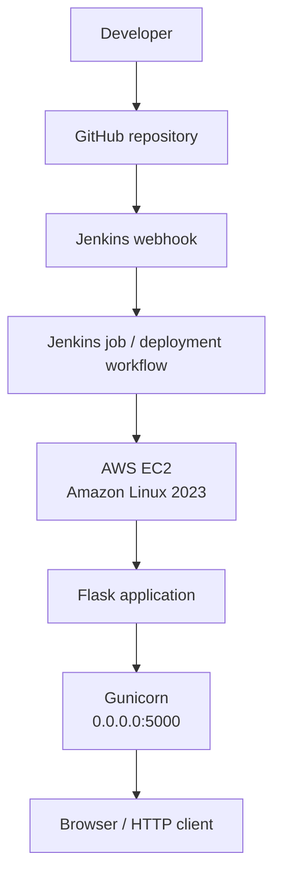
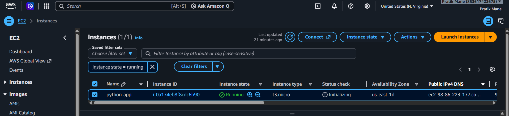
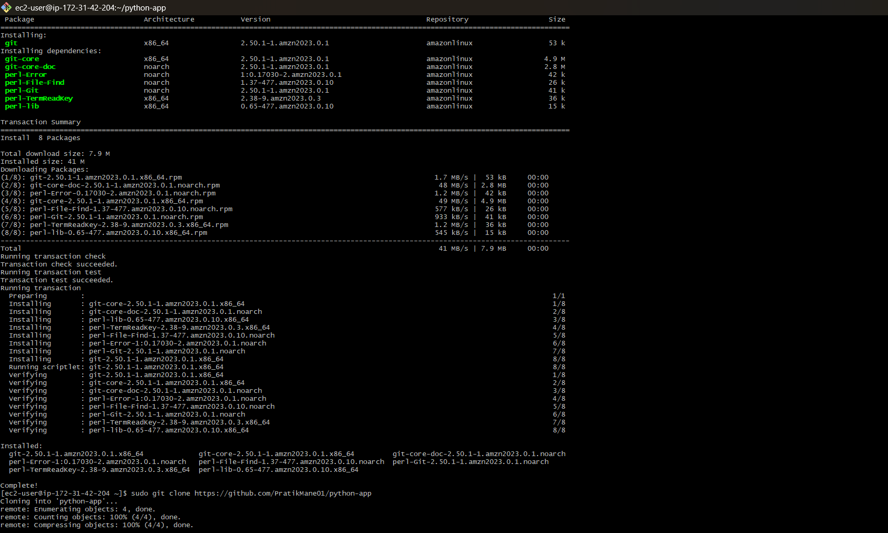
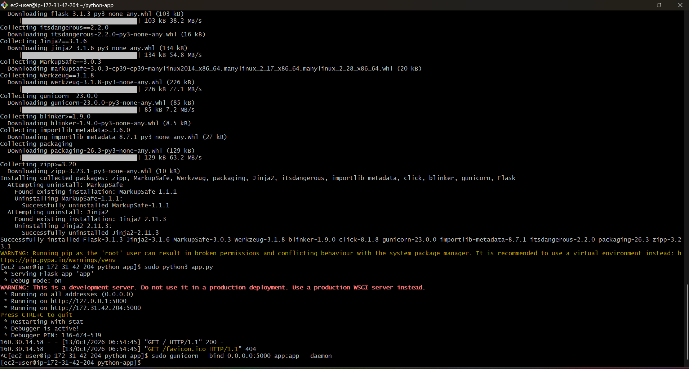

# Python Flask Application Deployment on AWS EC2 Using Gunicorn


## 1. Introduction

This hands-on project demonstrates deploying a small Python Flask web
application on an **Amazon EC2 instance running Amazon Linux 2023**. The
application source code was cloned from GitHub, dependencies were
installed with pip, and the application was served through **Gunicorn**
on port `5000`. A Jenkins webhook was also added as part of the
deployment workflow.

The purpose was to practice cloud infrastructure, Linux commands, Python
application setup, Git-based source control, and deployment
troubleshooting.

## 2. Architecture Diagram



**Request flow:** A browser requests the EC2 public IPv4 address on port
`5000`. Gunicorn serves the Flask application and returns the page
response.

> The screenshots confirm the app was served through Gunicorn and that
> the page was accessible. The full automated CI/CD flow should only be
> claimed after verifying that a GitHub push triggers Jenkins and that
> Jenkins deploys the updated application.

## 3. Project Inputs and Prerequisites

-   AWS account and an EC2 instance
-   Amazon Linux 2023
-   Python 3 and pip
-   Git
-   Flask application source code
-   `requirements.txt`
-   Gunicorn
-   EC2 security group configured to allow TCP port `5000` for testing
-   Jenkins and a repository webhook for the automation portion

**GitHub repository:** https://github.com/PratikMane01/python-app

## 4. Background and Setup

### Step 1 --- Update the system and install tools

``` bash
sudo dnf update -y
sudo dnf install python3 python3-pip git -y
python3 --version
pip3 --version
git --version
```

### Step 2 --- Clone the application

``` bash
git clone https://github.com/PratikMane01/python-app.git
cd python-app
ls
```

The project directory contains the application file (such as `app.py`)
and `requirements.txt`.

### Step 3 --- Create and activate a virtual environment

Run these commands as the normal EC2 login user, without `sudo`:

``` bash
python3 -m venv pythonenv
source pythonenv/bin/activate
```

### Step 4 --- Install dependencies

``` bash
python -m pip install --upgrade pip
python -m pip install -r requirements.txt
```

If pip reports that a pinned package version cannot be found, check the
version in `requirements.txt`, update it to an available compatible
version, and run the install command again.

### Step 5 --- Run the Flask application with Gunicorn

From the project directory, with the virtual environment active:

``` bash
gunicorn --bind 0.0.0.0:5000 app:app
```

This assumes `app.py` defines a Flask application object named `app`.

For temporary testing, a background process can be started with:

``` bash
gunicorn --bind 0.0.0.0:5000 app:app --daemon
```

For a more reliable long-running deployment, configure Gunicorn as a
`systemd` service instead of depending on a terminal session or daemon
flag.

### Step 6 --- Configure network access and test

In the EC2 security group, allow inbound **TCP port 5000** from your own
public IP address for testing. Then visit:

``` text
http://<EC2-PUBLIC-IP>:5000
```

Replace the placeholder with the instance's current public IPv4 address.
Do not publish a live public IP in a public README, and avoid leaving
port `5000` open to everyone.

### Step 7 --- Jenkins webhook

A GitHub webhook can notify Jenkins when repository changes occur. To
demonstrate complete automation, verify the webhook delivery, Jenkins
build trigger, repository checkout, deployment step, and application
health after deployment.

## 5. Project Screenshots and Output

### 5.1 EC2 instance

The EC2 console shows the `python-app` instance in the running state.



### 5.2 Python and pip installation

The terminal output shows Python 3 and pip setup on Amazon Linux 2023.


### 5.3 Git installation and repository cloning

Git was installed, and the project repository was cloned from GitHub.




### 5.4 Gunicorn serving the Flask application

The terminal shows Gunicorn binding to `0.0.0.0:5000` and HTTP requests
reaching the application.



### 5.5 Application visible in the browser

The browser successfully displays the application's response:

> successfully deployed python application through jenkins!!!!!!!!,
> added webhook


## 6. Result

The Flask application was accessible through the EC2 instance's public
IPv4 address on port `5000`. The terminal evidence shows Gunicorn
running the `app:app` application target, and the browser screenshot
shows the successful response.

## 7. Technologies and Skills Practiced

-   AWS EC2 and Amazon Linux 2023
-   Linux command-line administration
-   Python 3 and pip
-   Python virtual environments
-   Flask and Gunicorn / WSGI
-   Git and GitHub
-   EC2 security groups and network ports
-   Jenkins webhook concepts
-   Troubleshooting Python dependencies and application deployment

## 8. Conclusion and Next Steps

This project gave me hands-on practice deploying a Python web
application on AWS EC2, managing source code with Git, installing Python
dependencies, and serving Flask through Gunicorn. It also introduced the
role of Jenkins webhooks in a deployment workflow.

**Future improvements:** 1. Configure Gunicorn as a `systemd` service.
2. Add Nginx as a reverse proxy. 3. Configure HTTPS. 4. Restrict network
access and avoid exposing development servers publicly. 5. Verify and
document the full Jenkins pipeline from GitHub push to successful
deployment.

------------------------------------------------------------------------

**Project repository:** https://github.com/PratikMane01/python-app
